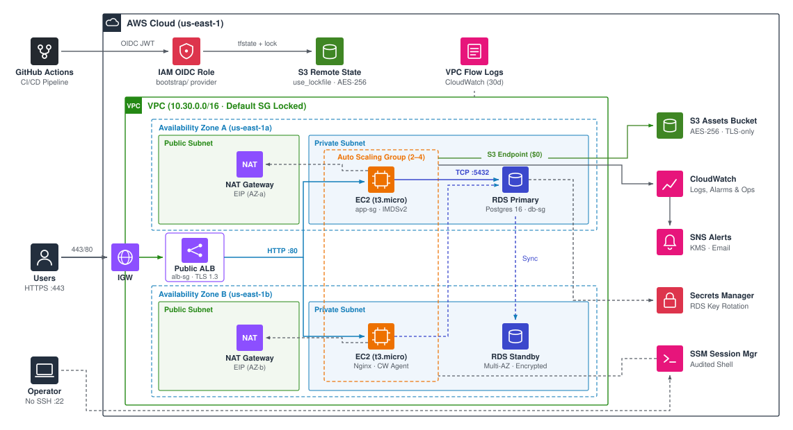

# Modular AWS Production Infrastructure (`aws-prod-infra`)

Production-ready, modular **Terraform** infrastructure provisioning a Multi-AZ VPC with a free S3 Gateway Endpoint, 3-tier security group chaining (`alb-sg -> app-sg -> db-sg`), Auto Scaling EC2 compute with IMDSv2 metadata + JSON logs, private RDS PostgreSQL 16, keyless GitHub Actions OIDC, CloudWatch/SNS observability + Ops Dashboard, native `terraform test` contracts, and **$0 local AWS integration testing** via [Floci](https://github.com/floci-io/floci).

---

## Architecture (`prod` High-Availability Topology)



*Cost-saving note: `staging` and `local-floci` keep spend at **$0** by placing a single `t3.micro` instance in a public subnet with the ALB, NAT Gateway, KMS CMK, and Multi-AZ RDS disabled, while keeping the free S3 Gateway Endpoint (`$0/hr`, `$0/GB`) enabled.*

---

## Environments & Cost Profile

| Layer | `local-floci` (Docker) | `staging` (AWS Free Tier) | `prod` (HA) |
|---|---|---|---|
| **VPC Egress & S3** | No NAT (`false`) | Free S3 Gateway Endpoint, No NAT | Per-AZ NAT + Free S3 Gateway Endpoint |
| **Ingress / Compute** | Emulated `t3.micro` | Public subnet `t3.micro` (`:80`) | Public ALB → Private ASG (2–4 `t3.micro`) |
| **Database (RDS)** | Local Postgres container | Single-AZ (`20 GiB`, IAM DB auth) | Multi-AZ (`7d` backup, Secrets Mgr, IAM auth, protected) |
| **Observability** | CW Log Group, Alarms & SNS | CW + RDS Alarms → SNS | CW Agent (JSON logs), VPC Flow Logs, Alarms → KMS SNS, Ops Dashboard |
| **Terraform State** | Local `.tfstate` | S3 + `use_lockfile = true` | S3 + `use_lockfile = true` |

---

## Security & Engineering Highlights

- **3-Tier Isolation & Zero SSH:** `alb-sg -> app-sg -> db-sg` chains traffic by security group ID. SSH port `22` (and unused staging port `443`) are closed everywhere; operator shell access uses **AWS SSM Session Manager**. Private subnets route S3 traffic over a **free S3 Gateway VPC Endpoint** instead of traversing the paid NAT Gateway.
- **IMDSv2, Encryption & TLS-Only S3:** EC2/Launch Templates enforce `http_tokens = "required"` and fetch instance ID/AZ via IMDSv2 at boot (`user_data.sh.tftpl`) with `dnf` retry resilience and structured JSON Nginx logs; EBS (`gp3`), RDS, S3, and production SNS alerts (customer-managed rotating KMS key permitting CloudWatch `kms:GenerateDataKey*`) enforce encryption at rest; S3 buckets block public access, deny non-HTTPS requests (`aws:SecureTransport = false`), and expire noncurrent versions after 90 days.
- **Keyless CI/CD & Least-Privilege IAM:** Account-wide GitHub OIDC provider lives in `bootstrap/`, trust policies use `StringEquals` on exact branch/environment subjects, `iam:PassRole` and `iam:AttachRolePolicy` are constrained strictly to repo-prefixed resources/SSM policy, and EC2 receives scoped `secretsmanager:GetSecretValue` + `rds-db:connect` permissions.
- **Secrets & Safe Replacements:** Production RDS delegates master password generation/rotation to **AWS Secrets Manager** (`manage_master_user_password = true`); security groups use `name_prefix` + `create_before_destroy`, EC2 ignores routine AMI drift, and RDS snapshots use `random_id` suffixes.
- **Strict Testing & CI Gates:** GitHub Actions enforces `terraform fmt`, `validate`, 17 native mocked `terraform test` contracts across all 6 modules + `prod`/`staging`, `tflint` (`.tflint.hcl`), `checkov` with targeted inline resource annotations (`.checkov.yml`), committed `.terraform.lock.hcl` lockfiles, and live Floci integration tests (39 resources, zero-drift re-plan verification, and 10 AWS CLI assertions).

---

## Repository Layout

```text
aws-prod-infra/
├── .github/workflows/terraform-ci.yml  # fmt, validate, terraform test, TFLint, Checkov, Floci & OIDC plan
├── .tflint.hcl / .checkov.yml          # AWS TFLint ruleset & FinOps Checkov policy config
├── bootstrap/                          # Versioned TLS-only S3 state bucket + shared GitHub OIDC provider
├── docs/architecture.svg               # High-level AWS production architecture diagram
├── environments/
│   ├── local-floci/                    # Local Floci emulator target (localhost:4566)
│   ├── staging/ (+ tests/)             # AWS Free Tier target & mocked composition contract tests
│   └── prod/ (+ observability.tf, tests/) # Production Multi-AZ HA target, CW dashboard & HA tests
├── modules/
│   ├── vpc/ (+ tests/)                 # Multi-AZ VPC, S3 Gateway endpoint, NAT, 3-tier SGs & Flow Logs
│   ├── iam/ (+ tests/)                 # Scoped EC2 profile (S3/CW/Secrets/RDS IAM), SSM & OIDC deploy role
│   ├── alb/ (+ tests/)                 # Public ALB, /healthz TG, TLS 1.3 listener & 5XX/health alarms
│   ├── alerts/ (+ tests/)              # Rotating KMS CMK + scoped SNS topic policy & alarms subscription
│   ├── compute/ (+ tests/)             # EC2 / ASG (IMDSv2 JSON bootstrap, gp3, CW Agent), S3 & alarms
│   └── rds/ (+ tests/)                 # Private PostgreSQL 16, Secrets Manager, IAM auth & alarms
├── scripts/verify-local.sh             # 10 AWS CLI security & resource assertions against Floci
├── docker-compose.floci.yml            # Pinned MIT-licensed local AWS emulator (floci/floci:2.5.0)
└── Makefile                            # Developer workflow shortcuts (including safe local `make clean`)
```

---

## Quickstart 1: Local Verification & Floci End-to-End Test ($0)

Requires Docker, Terraform `>= 1.10`, Python 3, and AWS CLI v2.

```bash
make floci-up                                  # Start Floci emulator on :4566
make validate-all                              # Check formatting & validate all 4 root configs
make test                                      # Run all 17 mocked Terraform unit & contract tests
make apply-local && make verify-local          # Provision 39 resources & run 10 security assertions
make destroy-local && make floci-down          # Tear down resources & stop Docker
```

*(Note: `make clean` only cleans local artifacts inside `environments/local-floci/` and will never delete `bootstrap/terraform.tfstate`.)*

## Quickstart 2: Real AWS Staging & Teardown

Requires authenticated AWS CLI credentials (`aws configure` or `aws sso login`) with permissions to create the bootstrap & environment stack.

```bash
# 1. Bootstrap remote S3 state bucket + shared GitHub OIDC provider (once per account)
terraform -chdir=bootstrap init
terraform -chdir=bootstrap apply -var="state_bucket_name=<unique-tfstate-bucket>"

# 2. Configure staging backend & deploy
cp environments/staging/backend.hcl.example environments/staging/backend.hcl
# Update bucket name in environments/staging/backend.hcl
export TF_VAR_db_password="<strong-password-without-/@\"-or-spaces>"
terraform -chdir=environments/staging init -backend-config=backend.hcl
terraform -chdir=environments/staging apply \
  -var="state_bucket_name=<unique-tfstate-bucket>" \
  -var="github_repo=<owner/repo>"

# 3. Destroy when done testing to stay at $0
terraform -chdir=environments/staging destroy \
  -var="state_bucket_name=<unique-tfstate-bucket>" \
  -var="github_repo=<owner/repo>"
```

### GitHub Actions OIDC & Production Notes

- **CI Staging Plan:** Create a GitHub Environment named `staging`, set repository variables `AWS_ROLE_ARN` (from `github_actions_role_arn` output) and `TF_STATE_BUCKET`, and add secret `STAGING_DB_PASSWORD`.
- **Production (`environments/prod`):** Enables `deletion_protection = true` on both ALB and RDS (`force_destroy_bucket = false` on S3), provisions the CloudWatch Ops Dashboard (`enable_dashboard = true`), and uses Secrets Manager (`manage_master_user_password = true`) so no `TF_VAR_db_password` is required. Disable deletion protection and empty the S3 bucket before running `terraform destroy` on `prod`.
