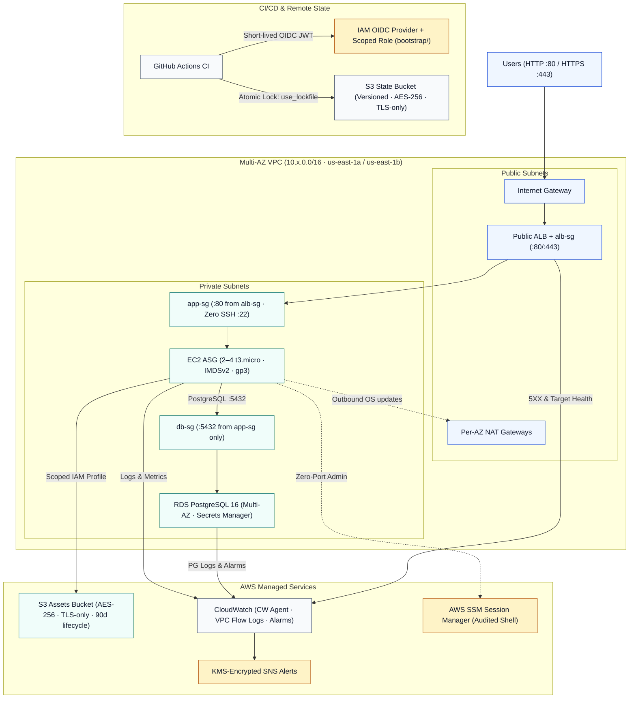

# Modular AWS Production Infrastructure (`aws-prod-infra`)

Production-ready, modular **Terraform** infrastructure provisioning a Multi-AZ VPC, 3-tier security group chaining (`alb-sg -> app-sg -> db-sg`), Auto Scaling EC2 compute, private RDS PostgreSQL 16, keyless GitHub Actions OIDC, CloudWatch/SNS observability, and **$0 local AWS integration testing** via [Floci](https://github.com/floci-io/floci).

---

## Architecture (`prod` High-Availability Topology)



*Cost-saving note: `staging` and `local-floci` keep spend at **$0** by placing a single `t3.micro` instance in a public subnet with the ALB, NAT Gateway, and Multi-AZ RDS disabled.*

---

## Environments & Cost Profile

| Layer | `local-floci` (Docker) | `staging` (AWS Free Tier) | `prod` (HA) |
|---|---|---|---|
| **NAT Gateway** | Disabled (`false`) | Disabled (`false`, saves ~$32/mo) | Per-AZ (`single_nat_gateway = false`) |
| **Ingress / Compute** | Emulated `t3.micro` | Public subnet `t3.micro` | Public ALB → Private ASG (2–4 `t3.micro`) |
| **Database (RDS)** | Local Postgres container | Single-AZ (`20 GiB`) | Multi-AZ (`7d` backup, Secrets Mgr, protected) |
| **Observability** | CW Log Group + Alarms | CW + RDS Alarms → SNS | CW Agent, VPC Flow Logs, ALB/RDS/ASG → SNS |
| **Terraform State** | Local `.tfstate` | S3 + `use_lockfile = true` | S3 + `use_lockfile = true` |

---

## Security & Engineering Highlights

- **3-Tier Isolation & Zero SSH:** `alb-sg -> app-sg -> db-sg` chains traffic by security group ID. SSH port `22` is closed everywhere; operator shell access uses **AWS SSM Session Manager**.
- **IMDSv2, Encryption & TLS-Only S3:** EC2/Launch Templates enforce `http_tokens = "required"`; EBS (`gp3`), RDS, SNS, and S3 enforce encryption at rest; S3 buckets block public access, deny non-HTTPS requests (`aws:SecureTransport = false`), and expire noncurrent versions after 90 days.
- **Keyless CI/CD (OIDC):** Account-wide GitHub OIDC provider lives in `bootstrap/` (preventing `EntityAlreadyExists` collisions), trust policies use `StringEquals` on exact branch/environment subjects, and `iam:PassRole` is restricted strictly to the EC2 and VPC Flow Logs roles.
- **Secrets & Safe Replacements:** Production RDS delegates master password generation/rotation to **AWS Secrets Manager** (`manage_master_user_password = true`); security groups use `name_prefix` + `create_before_destroy`, EC2 pins/ignores routine AMI drift, and RDS snapshots use `random_id` suffixes.
- **Strict CI Gates:** GitHub Actions enforces `terraform fmt`, `validate`, `tflint` (AWS ruleset via `.tflint.hcl`), `checkov` (`soft_fail: false` via `.checkov.yml`), committed cross-platform `.terraform.lock.hcl` lockfiles, and live Floci integration tests (`floci/floci:2.5.0`).

---

## Repository Layout

```text
aws-prod-infra/
├── .github/workflows/terraform-ci.yml  # fmt, validate, TFLint, Checkov, Floci CI & OIDC staging plan
├── .tflint.hcl / .checkov.yml          # AWS TFLint ruleset & documented Checkov FinOps policy config
├── bootstrap/                          # Versioned TLS-only S3 state bucket + shared GitHub OIDC provider
├── environments/
│   ├── local-floci/                    # Local Floci emulator target (localhost:4566)
│   ├── staging/                        # AWS Free Tier target
│   └── prod/                           # Production Multi-AZ HA target
├── modules/
│   ├── vpc/                            # Multi-AZ VPC, IGW, per-AZ NAT, 3-tier SGs & VPC Flow Logs
│   ├── iam/                            # Scoped EC2 instance profile, SSM, & OIDC deploy role
│   ├── alb/                            # Public ALB, /healthz TG, TLS 1.3 listener & 5XX/health alarms
│   ├── alerts/                         # KMS-encrypted SNS topic & optional email subscription
│   ├── compute/                        # EC2 / Multi-AZ ASG (IMDSv2, gp3, CW Agent), S3 & alarms
│   └── rds/                            # Private PostgreSQL 16, Secrets Manager & CPU/storage alarms
├── scripts/verify-local.sh             # 9 AWS CLI security & resource assertions against Floci
├── docker-compose.floci.yml            # Pinned MIT-licensed local AWS emulator (floci/floci:2.5.0)
└── Makefile                            # Developer workflow shortcuts
```

---

## Quickstart 1: Local End-to-End Test with Floci ($0)

Requires Docker, Terraform `>= 1.10`, Python 3, and AWS CLI v2.

```bash
make floci-up                                  # Start Floci emulator on :4566
make validate-all                              # Check formatting & validate all 4 root configs
make apply-local && make verify-local          # Provision 37 resources & run 9 security assertions
make destroy-local && make floci-down          # Tear down resources & stop Docker
```

## Quickstart 2: Real AWS Staging & Teardown

Requires authenticated AWS CLI credentials (`aws configure` or `aws sso login`) with permissions to create the bootstrap & environment stack.

```bash
# 1. Bootstrap remote S3 state bucket + shared GitHub OIDC provider (once per account)
# Keep bootstrap/terraform.tfstate backed up safely (avoid running `make clean` after real bootstrap).
terraform -chdir=bootstrap init
terraform -chdir=bootstrap apply -var="state_bucket_name=<unique-tfstate-bucket>"

# 2. Configure staging backend & deploy
cp environments/staging/backend.hcl.example environments/staging/backend.hcl
# Update bucket name in environments/staging/backend.hcl
export TF_VAR_db_password="<strong-password-without-/@\"-or-spaces>"
terraform -chdir=environments/staging init -backend-config=backend.hcl
terraform -chdir=environments/staging apply \
  -var="state_bucket_name=<unique-tfstate-bucket>" \
  -var="github_repo=<owner/repo>"

# 3. Destroy when done testing to stay at $0
terraform -chdir=environments/staging destroy -var="state_bucket_name=<unique-tfstate-bucket>"
```

### GitHub Actions OIDC & Production Notes

- **CI Staging Plan:** Create a GitHub Environment named `staging`, set repository variables `AWS_ROLE_ARN` (from `github_actions_role_arn` output) and `TF_STATE_BUCKET`, and add secret `STAGING_DB_PASSWORD`.
- **Production (`environments/prod`):** Enables `deletion_protection = true` on both ALB and RDS (`force_destroy_bucket = false` on S3) and uses Secrets Manager (`manage_master_user_password = true`) so no `TF_VAR_db_password` is required. Disable deletion protection and empty the S3 bucket before running `terraform destroy` on `prod`.
